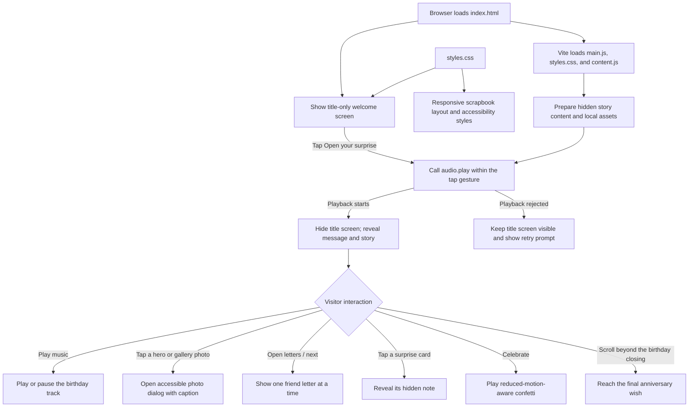

# Architecture and logic flow

This document explains the current codebase for a future maintainer. The site is a small static Vite application: it has no server-side code, API, database, or user-submitted data.

## Logic flow

## Files and responsibilities

- **`index.html`** is the semantic page shell. It defines the title-only welcome screen, hidden header/story/footer, birthday story sections, final anniversary screen, photo dialog, audio element, and accessible live status region. JavaScript reveals the main story after music playback starts.
- **`src/content.js`** is the single editing surface for personal copy and content records. Text is inserted with `textContent`, not interpreted as HTML. Memory groups connect a visible title to an ordered list of local images, alt descriptions, and lightbox captions. Timeline records have date/title and optional note/photo fields. Letter records have sender/message. Surprise records have icon/title/prompt/reveal text. An empty anniversary message hides the optional note below the final anniversary heading.
- **`src/main.js`** imports the content and stylesheet, prefixes local asset paths with Vite’s `BASE_URL`, writes the welcome/anniversary/closing messages, and creates the repeated gallery, timeline, and card markup. It then connects the controls described below.
- **`src/styles.css`** defines the palette, typography, scrapbook composition, responsive breakpoints, visible focus states, reduced-motion fallback, and animation styles. There are no runtime UI framework dependencies.
- **`vite.config.js`** sets the base URL to `/angie-birthday-website-26-11-2026/`, required for assets and module URLs when hosted under the GitHub Pages repository path.
- **`.github/workflows/deploy.yml`** installs the locked pnpm dependencies, builds `dist/`, and deploys it to GitHub Pages from the repository’s default branch. GitHub Pages must be configured to use **GitHub Actions** as its source.
- **`public/assets/photos/`** contains three supplied JPEGs displayed as an interactive scrapbook collage beside the main birthday message, 15 JPEGs in six titled memories groups, and an optional timeline photo. Hero-photo paths, alt descriptions, and captions are set in `index.html`; gallery group titles and photo details, plus timeline photo details, are configured in `src/content.js`. Four older SVG placeholders remain in the directory but are no longer used by the gallery.
- **`public/assets/audio/happy-birthday.mp3`** is the locally hosted background track, “Happy Birthday background music” by CrystalEyeOfficial. It is available under the Pixabay Content License. Source and license notes are recorded in the root README and `public/assets/audio/ATTRIBUTION.txt`.

## Page startup and content flow

1. The browser opens `index.html` and immediately shows the birthday title, **Open your surprise** button, and a short hint. Header navigation, story content, and footer are hidden.
2. `main.js` imports `content.js` and prepares the hidden story: it fills the personal birthday message, optional final December 1 anniversary note, and birthday closing wish, then renders gallery, timeline, and surprise cards.
3. When the visitor taps **Open your surprise**, the handler calls `audio.play()` directly in that user gesture. If its promise resolves, JavaScript hides the title screen, reveals the header, story, and footer, and focuses the message heading. If playback is rejected, the story stays hidden and an accessible retry prompt appears on the title screen.
4. The same local asset helper serves the hero images, gallery, and music so GitHub Pages subpaths resolve correctly. If `IntersectionObserver` is available and reduced motion is not requested, story content fades in as it enters view. Otherwise it is shown immediately.
5. Visitor actions update only the local page state. No information is sent to a service.

## Interactions

- **Title screen:** only the birthday title, **Open your surprise** button, and short hint are visible at first. The personal message is intentionally on the next screen.
- **Open your surprise:** the button calls `audio.play()` directly within the user gesture. When playback starts, JavaScript reveals the header, personal message, and the rest of the story, then focuses the message heading. If playback fails, the title screen remains visible and offers a retry.
- **Music control:** after opening, a persistent header button plays or pauses the looping local track and updates its accessible label and pressed state.
- **Hero photos and memories:** the memories renderer creates one titled subsection per group and an ordered button for every photo. Timeline photos are optional and use the same native `<dialog>`. Each scrapbook photo button opens the dialog with the selected image and caption. The dialog supports Escape and has a close button; clicking the backdrop also closes it.
- **Birthday letters:** the envelope starts closed. “Open the letters” reveals the first message. Previous/next controls update the single visible letter, sender, and `n of total` count. The final next action cycles back to the first note.
- **Little surprises:** each card button toggles its reveal text and keeps `aria-expanded` synchronized.
- **Closing celebration:** the button creates a short confetti burst. If reduced motion is enabled, the animation is skipped and a short birthday announcement is provided instead.
- **Final anniversary wish:** after the birthday closing screen, a dedicated last screen displays the anniversary heading and December 1 date. Its optional additional message comes from `content.js` and is hidden when empty. It is visually separate from the birthday message so the birthday remains the main focus.

## Responsive and accessibility behavior

The CSS starts from the title-only welcome screen and adapts at tablet and phone widths. The long birthday message uses a wider column on desktop and tablet and the full content width on phones. At phone sizes, navigation becomes a bottom pill, columns stack, gallery cards form a two-column grid, and surprise cards become full width. Buttons have focus indicators and accessible names; gallery thumbnails use empty alt text because their enclosing buttons provide names, while the enlarged image uses the memory alt description. The personal birthday message is the first story screen after the visitor opens the surprise and the song begins. The anniversary wish has its own final screen after the birthday closing. Reduced-motion preferences disable scroll/reveal/confetti movement. Typography uses local system font stacks; the site does not need a font CDN to render.

## Build and hosting

In Windows PowerShell, `npm.cmd install --no-package-lock` installs dependencies without creating an extra npm lockfile, and `npm.cmd run dev -- --host 0.0.0.0` starts Vite for local testing. Open the printed Local URL on the computer or the Network URL on another device on the same Wi-Fi. On macOS/Linux, use `npm install` and `npm run dev -- --host 0.0.0.0`. `npm.cmd run build` (or `npm run build`) produces the static `dist/` directory; `npm.cmd run preview` serves that output for local inspection. The GitHub Pages workflow publishes `dist/` from the repository’s default branch after **Settings → Pages → Source → GitHub Actions** is selected. The repository base is set in `vite.config.js`; if the repository name changes, update that value and rebuild. Publishing makes the site available at its HTTPS GitHub Pages URL independently of the local computer.

## Updating this document

When adding/removing files or changing startup, content fields, interactions, asset paths, or hosting behavior, update this guide and the project map in `README.md` in the same change.
