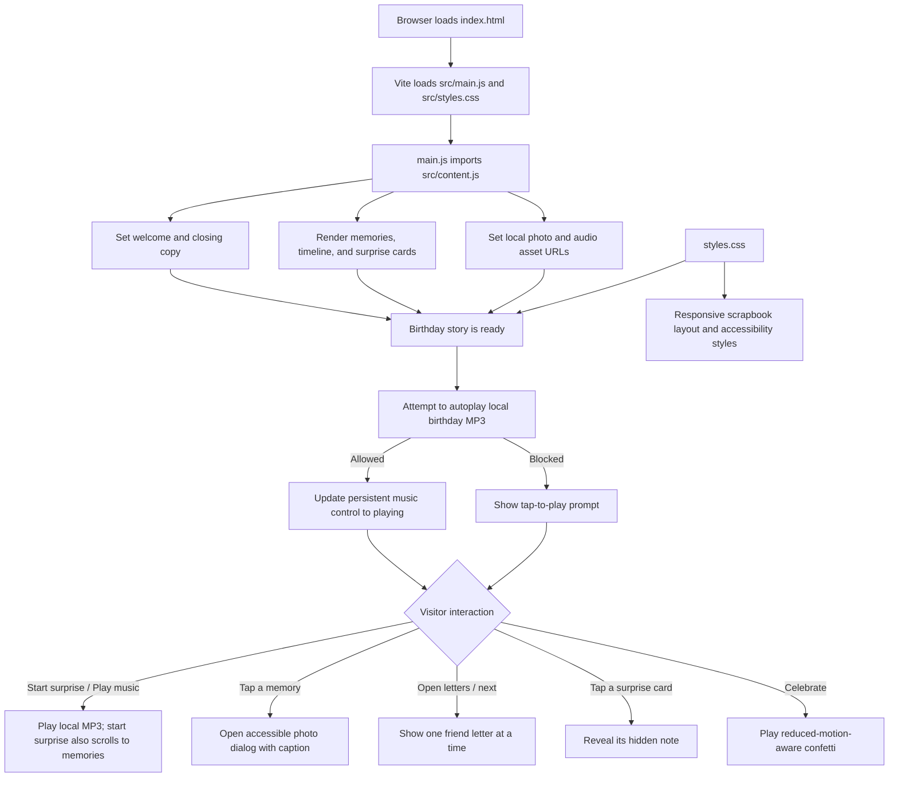

# Architecture and logic flow

This document explains the current codebase for a future maintainer. The site is a small static Vite application: it has no server-side code, API, database, or user-submitted data.

## Logic flow

## Files and responsibilities

- **`index.html`** is the semantic page shell. It defines the header/navigation, six story sections, photo dialog, audio element, and accessible live status region. JavaScript fills the content areas without rebuilding the entire page.
- **`src/content.js`** is the single editing surface for personal copy and content records. Text is inserted with `textContent`, not interpreted as HTML. Memory records connect a local image, alt description, caption, and short label. Timeline records have date/title/note. Letter records have sender/message. Surprise records have icon/title/prompt/reveal text.
- **`src/main.js`** imports the content and stylesheet, prefixes local asset paths with Vite’s `BASE_URL`, writes the welcome/anniversary/closing messages, and creates the repeated gallery, timeline, and card markup. It then connects the controls described below.
- **`src/styles.css`** defines the palette, typography, scrapbook composition, responsive breakpoints, visible focus states, reduced-motion fallback, and animation styles. There are no runtime UI framework dependencies.
- **`vite.config.js`** sets the base URL to `/angie-birthday-website-26-11-2026/`, required for assets and module URLs when hosted under the GitHub Pages repository path.
- **`.github/workflows/deploy.yml`** installs the locked pnpm dependencies, builds `dist/`, and deploys it to GitHub Pages from the repository’s default branch. GitHub Pages must be configured to use **GitHub Actions** as its source.
- **`public/assets/photos/`** contains four temporary SVG photo stand-ins. Replace them with supplied photos and update `src/content.js` paths/alt text.
- **`public/assets/audio/happy-birthday.mp3`** is the locally hosted background track. Its attribution and CC BY-NC 4.0 terms are recorded in the root README and `public/assets/audio/ATTRIBUTION.txt`.

## Page startup and content flow

1. The browser opens `index.html`. Vite loads the JavaScript entry and CSS.
2. `main.js` imports `content.js`; the welcome birthday headline is static HTML, while the personal birthday message, secondary December 1 anniversary note, and closing wish are populated from the content object.
3. Rendering functions create photo buttons, timeline entries, and surprise cards from their corresponding arrays. The same local asset helper is used by the hero images, gallery, and music player so GitHub Pages subpaths resolve correctly.
4. If `IntersectionObserver` is available and reduced motion is not requested, section content fades in as it enters view. Otherwise content is shown immediately.
5. Visitor actions update only the local page state. No information is sent to a service.

## Interactions

- **Music startup:** after setting the local MP3 source, `main.js` immediately calls `audio.play()` as a best-effort autoplay attempt. Browsers may reject audible autoplay until the visitor interacts; on rejection, a visible accessible prompt explains that the persistent **Play music** control can start the track. The audio element also declares `autoplay`, `loop`, and eager preload as hints, but these do not override browser policy.
- **Start the surprise:** calls `audio.play()` from the button click event, then scrolls to Memories. Successful playback dismisses the fallback prompt.
- **Music control:** a persistent header button plays or pauses the looping local track and updates its accessible label and pressed state.
- **Memories:** each button opens the native `<dialog>` with the selected image and caption. The dialog supports Escape and has a close button; clicking the backdrop also closes it.
- **Birthday letters:** the envelope starts closed. “Open the letters” reveals the first message. Previous/next controls update the single visible letter, sender, and `n of total` count. The final next action cycles back to the first note.
- **Little surprises:** each card button toggles its reveal text and keeps `aria-expanded` synchronized.
- **Closing celebration:** the button creates a short confetti burst. If reduced motion is enabled, the animation is skipped and a short birthday announcement is provided instead.

## Responsive and accessibility behavior

The CSS starts from the full page layout and adapts at tablet and phone widths. At phone sizes, navigation becomes a bottom pill, columns stack, gallery cards form a two-column grid, and surprise cards become full width. Buttons have focus indicators and accessible names; gallery thumbnails use empty alt text because their enclosing buttons provide names, while the enlarged image uses the memory alt description. The birthday message is visible immediately below the main birthday headline. The anniversary note is visually secondary. Reduced-motion preferences disable scroll/reveal/confetti movement. Typography uses local system font stacks; the site does not need a font CDN to render.

## Build and hosting

`pnpm dev` serves the site locally. `pnpm build` produces a static `dist/` directory; `pnpm preview` serves that output for local inspection. The GitHub Pages workflow publishes `dist/` from the repository’s default branch after **Settings → Pages → Source → GitHub Actions** is selected. The repository base is set in `vite.config.js`; if the repository name changes, update that value and rebuild. Publishing makes the site available at its HTTPS GitHub Pages URL independently of the local computer.

## Updating this document

When adding/removing files or changing startup, content fields, interactions, asset paths, or hosting behavior, update this guide and the project map in `README.md` in the same change.
